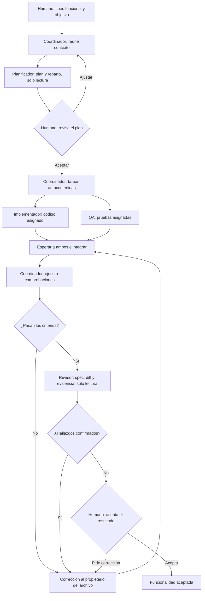

# Protocolo de desarrollo multiagente

Este procedimiento se reutiliza para desarrollar cualquier spec funcional o técnica que el humano indique. La spec de entrada define el incremento del producto, sus reglas y criterios de aceptación. Este protocolo contiene el proceso completo para planificar, implementar, probar y revisar ese incremento, incluida la creación de un proyecto cuando aún no existe código.

El chat principal de Cursor actúa como **coordinador**. Los especialistas existentes están en [`.cursor/agents/`](../.cursor/agents/): `planificador`, `implementador`, `qa` y `revisor`. El humano define el objetivo, revisa el plan y acepta el resultado. No hace falta crear un agente coordinador adicional ni introducir agentes dentro de la API.

**Estado:** protocolo documentado y roles definidos. La existencia de estos archivos no demuestra que se hayan invocado subagentes ni implementado una funcionalidad.

## Independencia y contexto necesario

Para iniciar se necesita este protocolo, **una spec de entrada** y acceso al proyecto donde se desarrollará: código, pruebas, configuración, reglas y herramientas disponibles. No es necesario leer o desarrollar otra spec, crear una skill ni completar una guía del curso para aplicar el patrón.

Las responsabilidades de los cuatro especialistas se describen aquí. Los archivos de `.cursor/agents/` configuran su invocación en Cursor; si la herramienta no puede invocarlos, se conserva el proceso con la alternativa descrita más adelante.

Una funcionalidad puede declarar dependencias reales de otras funcionalidades. El coordinador verifica si ya están resueltas en el código y la evidencia disponible. Solo consulta otro contrato si la spec de entrada lo requiere o falta información imprescindible para resolver esa dependencia. No carga ni ejecuta otras specs por defecto. Si una dependencia falta, informa qué impide y acuerda su tratamiento con el humano antes de ampliar el alcance. Esa dependencia pertenece a la funcionalidad, no al patrón.

## Entrada: una spec funcional o técnica

El humano indica la ruta de una spec y la fase deseada: planificar, desarrollar o revisar. El coordinador lee esa spec, README.md, las reglas del proyecto y el código relacionado que exista. En una creación desde cero, la ausencia de código, pruebas o README es parte del estado inicial, no una dependencia incumplida. Una spec debe contener:

- Objetivo o historia de usuario: quién necesita qué y para qué.
- Comportamiento esperado, contrato, reglas de negocio y errores.
- Alcance y exclusiones.
- Criterios de aceptación observables, con identificadores.
- Dependencias y restricciones conocidas del código o de los archivos.

El coordinador comprueba que el resultado esperado y sus criterios puedan verificarse. Si falta una decisión que cambia el comportamiento, se resuelve con el humano antes de implementar. Las decisiones rutinarias de implementación se proponen en el plan. Si cambia un requisito acordado, se actualizan primero la spec y el plan; después, código y pruebas.

## Aplicación a la creación y a una ruta de varias specs

Una spec técnica puede pedir crear la solución, configurar proyectos o preparar scripts. El coordinador asigna explícitamente esos archivos de raíz y configuración en el plan; por defecto son su responsabilidad. Los límites de implementador (`src/`) y QA (`tests/`) se mantienen. No se deja un archivo necesario sin propietario ni se asigna implícitamente al implementador una escritura fuera de su alcance.

Una spec de visión puede definir la idea, tecnologías, usuarios y alcance antes de construir. En esa etapa los especialistas revisan decisiones y criterios en solo lectura; el coordinador registra los acuerdos. La evidencia es la revisión y aceptación de esas decisiones, no una compilación ni pruebas de código inexistente. No se fabrican tareas de implementación para una etapa que solo pide definir el producto.

Cuando no existe proyecto, se prepara primero el contexto de coordinación: protocolo, spec, reglas y roles. Tras la revisión del plan, el coordinador crea en secuencia el esqueleto mínimo, los `.csproj`, referencias y solución. Luego entrega la propiedad de los archivos de código y pruebas a los especialistas. Estos pueden escribir en paralelo a partir de esa base y el contrato acordado. El coordinador tampoco compila mientras haya ediciones en curso. No se exige una skill instalada ni una guía del curso para comenzar.

Si el humano pide expresamente construir una ruta completa, el índice de specs determina el orden y las dependencias de ese proyecto. El coordinador prepara el plan de la ruta y aplica este mismo ciclo a cada spec; no crea otro protocolo. Las etapas que comparten archivos se ejecutan en secuencia. Solo avanza después de comprobar y revisar la etapa anterior y de respetar el acuerdo de aceptación humana. Si ya se autorizó continuar toda la ruta, no pide de nuevo esa misma autorización; las decisiones que cambien el alcance vuelven al humano.

Esta modalidad no convierte un índice ni otras specs en dependencias obligatorias del patrón. Cuando se recibe una sola spec, solo se desarrolla esa entrada y se comprueban sus dependencias declaradas. En proyectos existentes se reutiliza lo correcto; no se sobrescribe la base para simular que se empieza desde cero.

## Flujo



1. **Preparar el contexto.** Revisar el estado real del código y `git status`; conservar los cambios existentes, incluidos los archivos sin seguimiento. Identificar el estado inicial que permitirá distinguir el cambio de esta tarea y las dependencias pendientes. Si no hay una base Git utilizable, conservar una comparación de los archivos antes y después, sin crear commits implícitamente. Antes de recompilar, detener únicamente una instancia de la aplicación identificada que impida esa compilación. Crear una rama de trabajo cuando corresponda.
2. **Planificar.** El planificador trabaja en solo lectura. Contrasta la spec con el código y propone el cambio mínimo, casos de aceptación, archivos por responsable, orden y dependencias de las tareas, riesgos y comandos de verificación. Cada criterio debe tener una comprobación prevista. Distingue tareas paralelas de tareas que requieren una entrega anterior.
3. **Revisar el plan con el humano.** Presentar comportamiento, casos y reparto antes de editar. Si ya existe un plan aceptado en la conversación y el alcance no cambió, continuar desde él; no volver a pedir la misma aprobación.
4. **Delegar.** Enviar tareas completas a implementador y QA con el contrato de la spec actual. Pueden escribir en paralelo solo cuando sus archivos sean distintos. Si necesitan editar el mismo archivo, el coordinador secuencia esa parte o acuerda aislamiento en worktrees.
5. **Esperar e integrar.** Ambos entregan archivos, decisiones y pendientes. Nadie compila ni ejecuta pruebas mientras cualquiera siga escribiendo en el checkout compartido. El coordinador inspecciona el estado conjunto cuando todos terminan.
6. **Verificar.** El coordinador ejecuta las comprobaciones acordadas del cambio y la regresión pertinente sobre el estado integrado. Determina los comandos a partir de la configuración y documentación del proyecto; en este repositorio la suite es `dotnet test CursoCursor.slnx`. Relaciona cada criterio de la spec con su prueba o comprobación observable y su resultado. Una prueba escrita o un comando sin casos ejecutados no demuestra aceptación. Se conservan comando, resultado real y pendientes. Una skill puede facilitar esta labor, pero su ausencia no impide ejecutar el procedimiento.
7. **Corregir y revisar.** Asignar cada fallo al propietario del archivo, esperar sus cambios y repetir las comprobaciones afectadas. El revisor independiente recibe la spec, el diff y las salidas reales; inspecciona en solo lectura. El coordinador contrasta los hallazgos antes de pedir correcciones y vuelve a verificar los cambios.
8. **Aceptar.** Mostrar al humano comportamiento, criterios cubiertos, delegaciones realizadas, pruebas, revisión y límites. Si falta una comprobación o persiste un defecto, declarar el pendiente. Crear commits, publicar, comentar un PR o fusionar requiere una instrucción explícita y no es efecto automático de este protocolo.

## Responsabilidades y propiedad de archivos

| Responsable | Responsabilidad | Escritura |
|---|---|---|
| Humano | Define objetivo, revisa plan y acepta el resultado. | Decide cambios del contrato. |
| Coordinador | Reúne contexto, reparte, integra, ejecuta comprobaciones y gestiona correcciones. | Archivos de raíz, esqueleto, scripts o configuración asignados expresamente en el plan. Sin escritura sobre archivos delegados a otro responsable. |
| Planificador | Contrasta la spec y el código, propone tareas y dependencias. | Ninguna; solo lectura. |
| Implementador | Implementa el comportamiento acordado. | Solo archivos de `src/` asignados en el plan. |
| QA | Crea pruebas independientes contra los criterios de la spec. | Solo archivos de `tests/` asignados en el plan. |
| Revisor | Inspecciona contrato, diff y evidencia; reporta hallazgos reproducibles. | Ninguna; solo lectura. |

Los archivos concretos dependen de la funcionalidad y se asignan en el plan. Cada archivo tiene un único propietario de escritura durante una tarea; cualquier cambio de propietario se coordina antes de editar. La asignación explícita evita ediciones concurrentes; la separación de contexto por sí sola no aísla archivos.

Cada tarea delegada incluye **objetivo, spec y contrato completo pertinente, contexto del código, criterios de aceptación, archivos permitidos, dependencias, límites y entrega esperada**. No se presupone que un especialista haya leído la conversación principal. La entrega identifica lo inspeccionado, lo escrito y lo realmente ejecutado.

Los hallazgos del revisor incluyen ubicación, condición que los activa, resultado actual, resultado esperado, impacto y reproducción. No se debilitan pruebas para ocultar un fallo. Las correcciones que cambian el contrato regresan a la planificación con el humano.

## Contrato de una tarea delegada

El coordinador completa este formato para cada especialista. Incluye el contenido pertinente; una ruta por sí sola no sustituye el traspaso de contexto.

```text
Rol y objetivo: [responsable y resultado esperado].
Spec de entrada: [ruta y versión o contenido vigente].
Contrato: [comportamiento, reglas, entradas, salidas y errores pertinentes].
Criterios: [IDs y condiciones completas que debe satisfacer la tarea].
Contexto: [archivos, símbolos, patrones y decisiones del plan aceptado].
Archivos de lectura: [rutas necesarias].
Archivos de escritura: [rutas exactas, o ninguno para roles de solo lectura].
Dependencias: [qué debe recibir antes de empezar y quién lo entrega].
Límites: [acciones fuera del alcance y restricciones de ejecución].
Entrega: [resultado, archivos, decisiones, cobertura, evidencia y pendientes].
```

El planificador entrega el plan sin editar. El implementador entrega el cambio y explica su comportamiento. QA entrega casos vinculados a criterios; cuando solo escribió pruebas, declara que no las ejecutó. El revisor entrega hallazgos reproducibles o indica que no encontró hallazgos dentro del alcance inspeccionado. Todos comunican bloqueos o necesidades de ampliar archivos al coordinador antes de actuar fuera de su asignación.

## Integración, fallos y revisión

- El coordinador espera a todos los responsables que estén editando, comprueba archivos nuevos y modificados y resuelve inconsistencias entre las entregas. Nunca descarta cambios previos para facilitar la integración.
- Si dos tareas necesitan el mismo archivo, se asigna un propietario y se secuencian las ediciones. En worktrees, los conflictos se resuelven al integrar antes de ejecutar la verificación final.
- Ante un fallo, distingue defecto del cambio, fallo previo y problema del entorno. Registra la condición y el resultado observable; asigna una corrección acotada al propietario. No modifica expectativas para hacer pasar una prueba.
- Si falta una herramienta, acceso o dependencia, deja la comprobación pendiente con su motivo y el siguiente paso. No presenta como satisfactorio un resultado que no pudo comprobar.
- Después de corregir, espera las ediciones, verifica de nuevo los casos afectados y las regresiones pertinentes y entrega el diff final y su evidencia al revisor. Una revisión anterior no cubre automáticamente las correcciones posteriores.

## Condición de terminado y entrega al humano

El desarrollo está listo para aceptación cuando todos los criterios de la spec están comprobados, las pruebas pertinentes pasan sobre el estado integrado, el cambio respeta el alcance, la revisión independiente cubre el diff final y los hallazgos confirmados están resueltos. Si falta una de estas condiciones, se informa como trabajo pendiente.

El coordinador entrega:

1. Comportamiento implementado y archivos afectados.
2. Tabla **criterio → prueba o comprobación → resultado real**.
3. Comandos ejecutados, resultados y limitaciones del entorno.
4. Especialistas realmente invocados o modalidad alternativa utilizada.
5. Resultado de la revisión y correcciones verificadas.
6. Pendientes, si existen, y estado de aceptación humana.

La aceptación humana se registra en la conversación; no se infiere de que una spec exista ni de que las pruebas pasen. Con dependencias o comprobaciones pendientes, se puede presentar un avance, pero no declarar la funcionalidad terminada.

## Cuando no hay subagentes o se usan worktrees

Si la herramienta no permite invocar subagentes, decirlo antes de delegar. Se pueden usar chats separados con traspaso manual, manteniendo contrato, reparto y espera. Si una sola sesión realiza las tareas en secuencia, describirla como ejecución secuencial. Ninguna de esas modalidades se presenta como subagentes invocados automáticamente.

Los worktrees son una opción de aislamiento. Cada copia parte de una base conocida y recibe el contexto completo. Después de terminar las tareas, integrar los cambios en secuencia, resolver conflictos y verificar sobre la copia que contiene ambos resultados. No son un requisito para todas las specs.

Si no existe una segunda sesión capaz de realizar la revisión independiente, informar esa limitación. Una autorrevisión puede ayudar a avanzar, pero no se presenta como revisión independiente completada.

## Prompt de entrada

Sustituye `specs/mi-funcionalidad.md` por la spec que quieras desarrollar. Esa es la única spec de entrada requerida por el protocolo.

```text
Desarrolla la funcionalidad de specs/mi-funcionalidad.md siguiendo
docs/flujo-multiagente.md. Actúa como coordinador del chat principal.

Lee la spec, README.md, las reglas del proyecto y el código relacionado.
No cargues ni ejecutes otras specs por defecto; consulta otro contrato
solo si hace falta para una dependencia declarada de esta funcionalidad.
Usa planificador en solo lectura y presenta el plan con archivos por
responsable, dependencias y pruebas de los criterios de aceptación.
Espera mi revisión antes de editar; si el plan ya está aceptado en esta
conversación y no cambió el alcance, continúa desde él.

Después delega código a implementador y pruebas a qa con tareas
autocontenidas y archivos separados. Espera a ambos antes de compilar.
Integra, ejecuta las comprobaciones de la spec y la regresión, solicita
revisión independiente a revisor y corrige los hallazgos confirmados.
Presenta comportamiento, criterios cubiertos, resultados reales y
pendientes para mi aceptación. No crees commits, publiques ni fusiones ramas.
Si no puedes invocar subagentes, informa la limitación sin simularlos.
```

Para continuar tras revisar el plan:

```text
Apruebo el plan. Continúa con el reparto acordado y completa la
implementación, las pruebas y la revisión conforme al protocolo.
```
